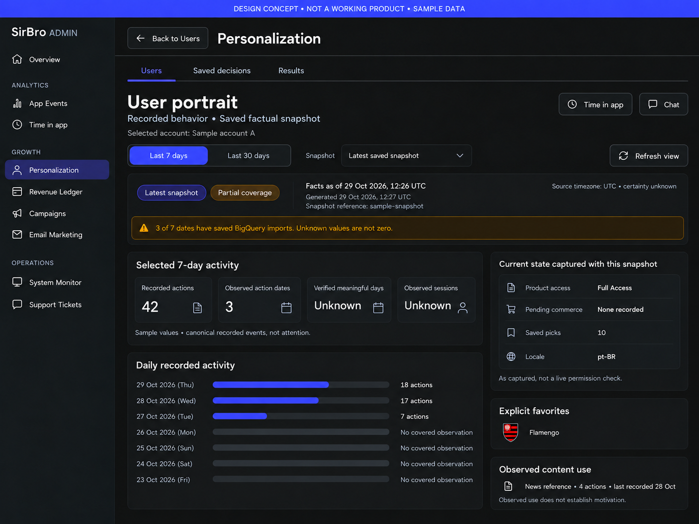
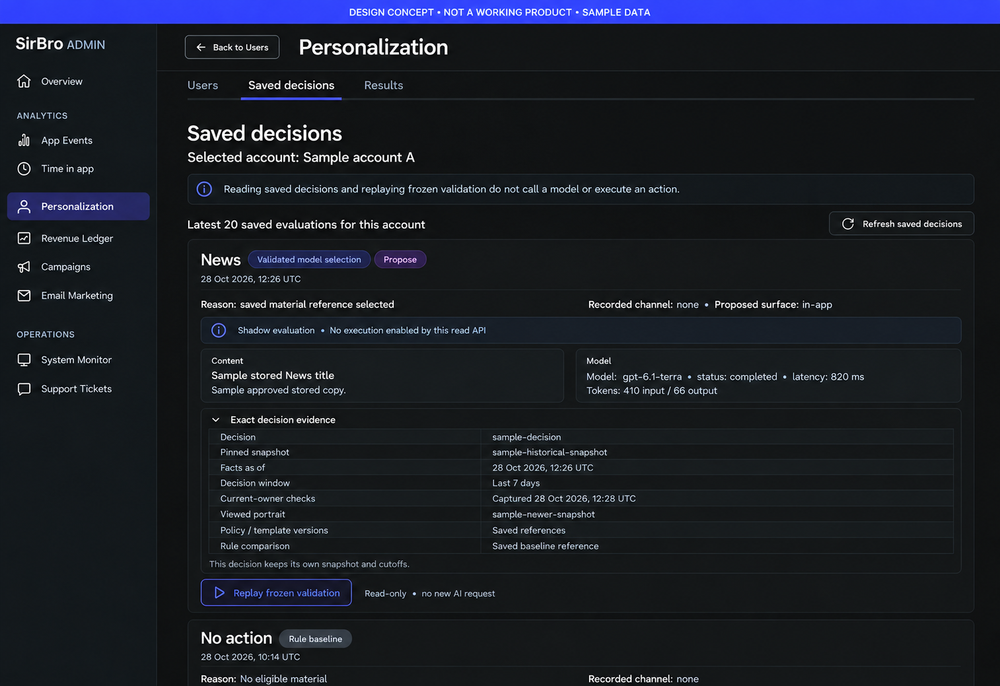
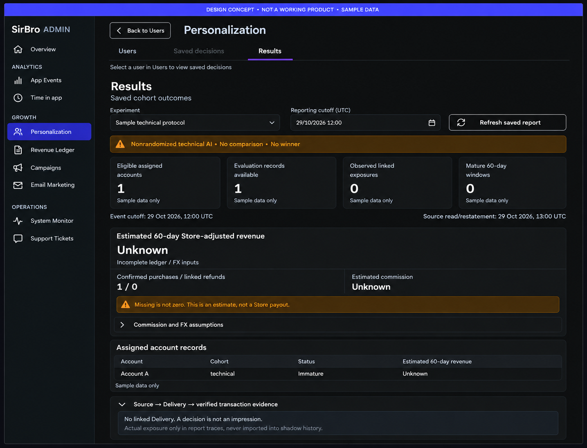
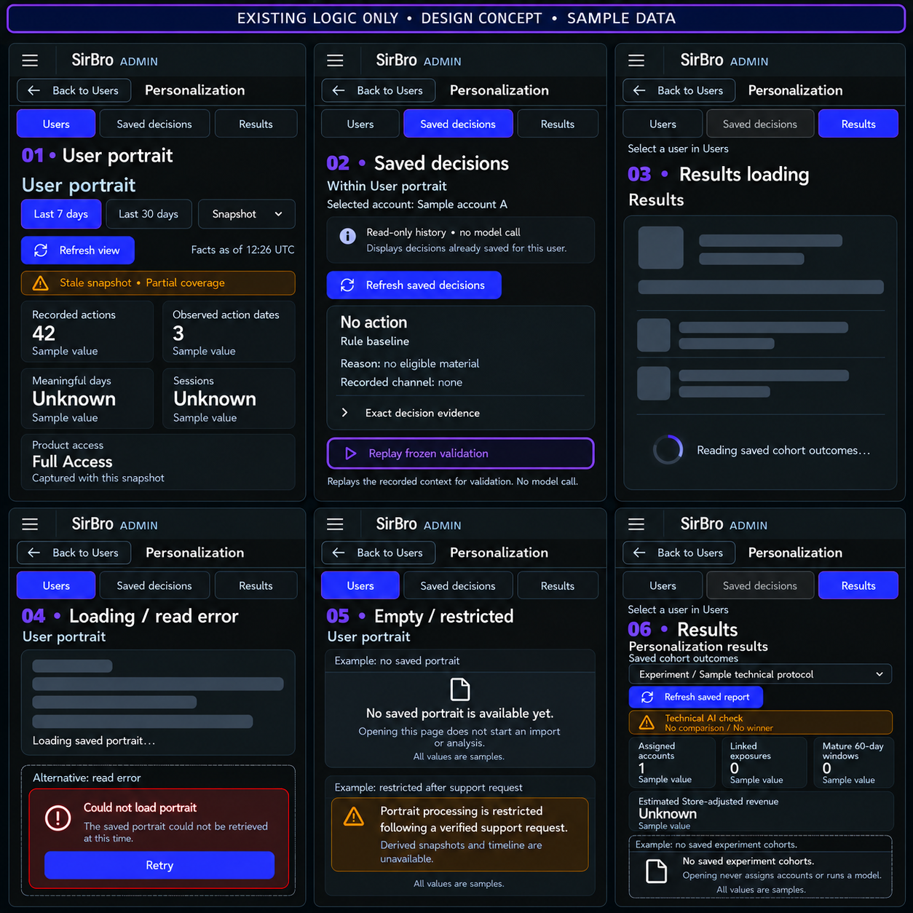

# English concepts — existing logic only

> Implementation amendment, 29 October 2026: the owner subsequently authorized a
> real **Settings** tab with a persisted minimum interval, default **6 hours**.
> This replaces the earlier exclusion of settings/API changes for this one feature.
> The interval replaces old daily/weekly limits only for `portrait_decision`
> personalized contacts. Product/service Campaign rules remain unchanged; consent,
> deduplication and quiet windows remain enforced. Settings uses the existing admin
> authorization and shared UI components. Original raster concepts below predate
> this fourth horizontal tab; they continue to define the other three screens.
> Implementation contract and final proof: [PERSONALIZATION.md](../../PERSONALIZATION.md)
> and [UI-EVIDENCE.md](UI-EVIDENCE.md).

These replace the earlier broader Russian concepts. All retained designs use English and only existing data/actions. The corrected navigation has one Personalization sidebar entry and horizontal Users / Saved decisions / Results tabs in the content area on every screen. They are **design concepts, not working product screenshots**. All account labels, values and dates are illustrative.

The current contract mapping, limitations and future presentation-only implementation plan are in [PLAN.md](PLAN.md). Independent plan review is recorded in [REVIEW.md](REVIEW.md).

| Concept | Existing source surface |
| --- | --- |
| [01-user-portrait.png](concepts/01-user-portrait.png) | UserPortrait, same canonical Users URL; existing 7/30-day and snapshot controls |
| [02-saved-decisions.png](concepts/02-saved-decisions.png) | PortraitDecisionHistory inside that account's portrait; latest 20 and frozen replay |
| [03-results.png](concepts/03-results.png) | Existing UserExperimentScorecard directly available to authorized admins; no additional password screen |
| [04-narrow-existing-states.png](concepts/04-narrow-existing-states.png) | Existing narrow portrait/history/report and loading/error/not-ready/restricted states |

## Strict scope

- Personalization is exactly one sidebar menu item, with no Users/Results sidebar children. Its common content header contains horizontal Users / Saved decisions / Results tabs. The same tabs remain horizontal on narrow screens. This presentation shell reuses existing routes and data owners; it adds no overview or settings capability. Saved decisions is enabled only for a selected account; otherwise it is disabled with a select-user explanation.
- No global overview/counters, portrait-status directory/filter, global AI journal, settings page, live communication-permission panel, candidate editor, send button or embedded financial-only unlock remains.
- No new backend API, persistence, model behavior, owner join or user preference is implied. Existing decision reasons and snapshot cutoffs retain their meanings.
- Report Delivery evidence stays in existing scorecard traces. Shadow history does not gain actual delivery status.
- Personalization has no extra password gate or unlock screen. The owner explicitly requested removal of the results-only RevenueLedgerAccessGate wrapper. Standard admin authentication and server authorization remain; the separate Revenue Ledger route keeps its existing gate. This is a scoped future frontend change, not a change already made to the product.
- The existing source contains additional portrait and results sections below the illustrated crops. Preserve them in implementation; a concept crop is not a deletion instruction.
- On the narrow state board, labelled empty/error/restricted examples are alternative states, not simultaneous live content. No password form or access-check state appears in Personalization.
- Sample data never establishes current pilot status, operational worker health, live consent, mature revenue or a winner. Unknown values are not zero.

## Unified header and visual proof

All four images were edited with built-in imagegen. The current revision removes the password screen, exposes Results directly under standard admin authorization, and uses the existing AdminPageHeader layout: one small outlined ArrowBack / Back to Users button before the Personalization title in the top header, with tabs below. Inline and right-side duplicates are removed. The single sidebar entry, horizontal tabs, account-scoped history and other accepted content stay unchanged. Exact repair prompts are retained in [PROMPTS.md](PROMPTS.md).

These are raster concepts. Fresh running-app screenshots under ui-evidence-proof are required during separately authorized implementation. No product runtime or build was started for this design task.

